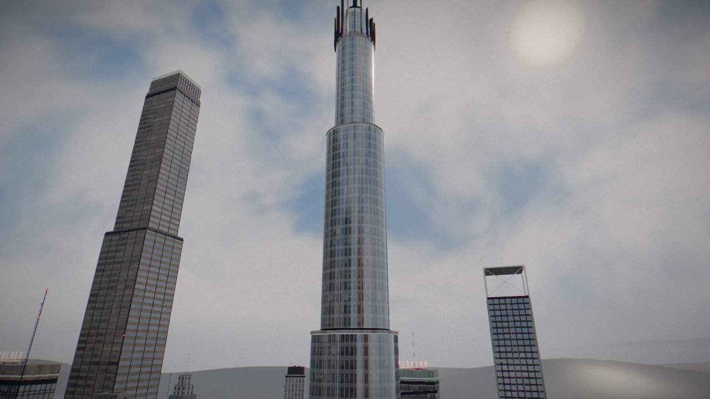

# Tower facades: the baked approach

**This is how tower facades are made in this project.** If you are adding or changing a tower's
look, start here. (Low and mid-rise buildings use the procedural approach, `lib/building.walls()`
with shader-drawn windows; the photo bundles are retired. See "Which method for which building" below.)



## The idea in one paragraph

A tower facade is **modelled in Blender** as real geometry: piers, spandrels, recessed glass,
frames, mullions, sills, blinds, AC units, balconies, fins. It is then **rendered straight on with
an orthographic camera**. A flat facade seen straight on *is* its own texture, so there is no UV
unwrap and no bake setup. Each map is one Cycles render in which every material is reduced to an
emission of the quantity wanted (albedo, roughness, normal, glass mask, blind mask, AO), so no
lighting leaks into any map. A packing step adds grime, lit rooms and tangent-space normals, and
writes the **exact** floor and bay grid, because the generator *chose* it. Nothing is measured
from pixels afterwards.

## Why it beats the alternatives

| | Photo / AI-generated texture sets (legacy) | Fully procedural shader windows | **Baked facades** |
|---|---|---|---|
| Maps agree with each other | No: emissive, mask and roughness were generated separately and showed *different windows* | Yes | **Yes, by construction**: every map renders the same model |
| Floor / bay grid | Measured from pixels, curated by hand, fragile (wrong periods, cut rows) | Exact | **Exact**, written by the generator |
| Detail | High but uncontrolled (louvres, odd panels, baked lighting) | Limited to what a shader can draw cheaply | **High and controlled**: real depth, AO, blinds, AC units, balconies, fins |
| Variety | Whatever the source gave | Parametric | **Parametric**: a style is ~15 JSON fields |
| Runtime cost | One texture-array lookup | Shader maths per window | **Same as photos**: same KTX2 array, same shader path |
| Iteration | Regenerate, re-measure, repair | Edit GLSL | **Edit JSON, `npm run facades:bake`** (~30 s per style) |

The photo bundles took many rounds of grid measuring, curated periods, crops, emissive rebuilds and
roughness repairs (docs/NOTES.md, "Facade emissive" and the facade-grid rounds). Every one of those
problems is impossible here: the generator knows where every window is.

## Pipeline

```
art/facades/<bundle>.json              styles (Blender units: metres; colours: palette names)
        │  npm run facades:bake [-- <bundle> [<style id>]]
        ▼
tools/blender/bake_facades.py          model each style, render 6 passes straight on (Cycles)
        │                              → build/facades/<bundle>/<style>/{albedo,rough,normal,glass,blind,ao}.png + layout.json
        ▼
tools/textures/pack_facades.py         AO, periodic grime, lit rooms (art/textures/interiors), tangent normals
        │                              → art/textures/facades/<bundle>/{diffuse_rough,emissive,normal}.webp
        │                              → art/textures/facades/<bundle>.json (rect, grid, floor, bay, wrap per style)
        ▼
npm run textures                       KTX2 (art/textures/ktx2.def.json) → public/textures/tower_<bundle>_*.ktx2
        ▼
src/materials/textures.ts              TOWER_BUNDLES / TOWER_FACADES: one texture-array layer per bundle
src/materials/facade.ts                the "atlas" surface: whole floors and bays per module, lit floors, spill, glass reflection
```

Everything is deterministic: the style's `seed` drives every random choice, and the packed
outputs are byte-identical between runs (the intermediate PNGs differ only in metadata).

### Atlas layout

Each bundle is one 2048² texture with a 4×2 grid of cells (464×976 px usable, at 24 px/m:
about 19 × 40 m of facade). Slots 0–6 are the **city pool**: towers pick from them by seed.
Slot 7 is free for a **pinned** style that only one asset wears (in `baked` it is
`landmark_pearl`, worn by the round landmark).

Shader index (`TOWER_FACADES`, also the `?inspect=…&facade=<n>` number): 0–27 is the pool
(baked_osaka 0–6, baked_glass 7–13, baked_sky 14–20, baked 21–27), then 28+ for pinned styles
(28 = baked `landmark_pearl`).

## A style

```jsonc
{
  "id": "landmark_pearl",
  "wall": "panel",                       // brick | tile | concrete | panel (curtain-wall spandrel)
  "colors": ["panel_pearl", "panel_pearl_alt", "mullion_pearl"],   // wall, wall variation, joints
  "floor": 3.8, "bay": 1.5,             // one floor = spandrel + window; one bay = pier + opening
  "pier": 0.14, "spandrel": 0.9,         // solid wall between openings
  "panes": 1, "transom": 0.0,            // mullions per opening, top-light height
  "frame": "mullion_pearl", "sill": "mullion_pearl",
  "blinds": 0.25,                        // share of windows with blinds or curtains drawn
  "ac": 0.0, "balconies": 0.0,           // share of windows with an AC unit / a balcony
  "fins": 0.35,                          // depth of a vertical fin on every pier (0 = none)
  "rooms": "office",                     // interiors set behind lit windows: office | residential
  "room_width": [5.0, 14.0],             // optional: room widths in metres (lit as a whole)
  "seed": 18
}
```

Optional fields, for glass office towers (`baked_glass.json`, `baked_sky.json`):

```jsonc
  "glass": "glass_teal",                 // the style's glass (default glass_facade)
  "glass_vary": 0.3,                     // 0–1: how far each window's tint may wander (1 = six-tint spread)
  "glass_reflect": 0.5,                  // how strongly the glass colour tints its reflection (default 0.5)
  "spandrel_colors": ["panel_grey", "panel_grey", "mullion_dark"],  // spandrels in their own material…
  "spandrel_wall": "panel",              // …and kind, e.g. stone piers over glass spandrels
  "wall": "stone"                        // a fourth wall kind: large smooth panels, fine joints
```

A style with `glass` gets a `tint` in its packed JSON: the glass colour normalised to its brightest
channel, which the shader multiplies into the reflection. Coated glass reflects in its own hue;
without it, every glass tower by day showed the same grey sky and the styles could not be told
apart.

Rules that keep it clean:
- **Colours are palette names** (`art/style/palette.json`), never hex.
- **Brick and tile sizes are derived to divide the bay and floor exactly**, so the texture tiles
  on its grid with no seam.
- **Only glass reflects.** The shader treats roughness below ~0.6 as glass (sky and city
  reflection), so the packer floors everything outside the glass mask to matte
  (`WALL_ROUGH_MIN` = 0.68 in `pack_facades.py`). Glazed tile (0.45) and curtain-wall spandrel
  panels (0.15) used to mirror the sky like the windows.
- **Rooms, not windows, are lit.** The packer splits every floor into rooms several bays wide
  (`room_width` per style, in metres; default 5–14 m for offices, 3–7 m for `residential`).
  A lit room shows one light in all its windows: one room card across the room, one tint, and
  brightness falling off from where the light is. The window next to a lit room shows a dim
  version of that room (15–25 %, `SPILL`), fading away from the lit side. Lighting single
  windows looked like isolated boxes on tall-window facades.
- **The grid starts at a pier centre and a spandrel centre**, so the edges of every repeat lie on
  wall, never through glass.
- **The runtime shows a facade's floor at the curtain cell height, 3.8 m** (`facade.json`
  cells.curtain). A style with another floor height is scaled to it. If geometry must land
  on mullion lines (a curved tower's facets), give the style `floor: 3.8` and a bay that divides
  the facet width.

## Putting it on a building

Faces of surface kind `"atlas"` wear a tower facade. There are two ways to choose which one:
- **From the pool (default):** `surf(ctx, "atlas", 1.0, tint)`. The building's seed picks a
  bundle and a style; most towers do this (`buildings/tower`).
- **Pinned:** `surf(ctx, "atlas", atlas_pin(28), tint)` (`lib.surface.atlas_pin`). This is for
  landmarks that should look like themselves, not like a random tower.

Every atlas face needs a **facade module** (`module=(width, height)`, see AGENTS.md "Facade
modules"). At runtime whole floors and bays are fitted into each module at whatever scale the
layout gives the building, so no window row or column is ever cut at a band's edge, a corner or a
setback. `npm run facades` fails on a window face without one.

### Curved and faceted towers (`buildings/roundtower`)

These lessons were learned on the round landmark:
- **Make facets exactly one bay wide** (or whole bays). For a quarter circle of `n` facets of
  width `f`, the radius is `f / (2 sin(π / 4n))`. Then the curve bends on mullion lines.
- **Run u continuously around the ring and give it one module** (the perimeter × the band's
  height).
- **Make each ring's perimeter whole texture repeats** (12 bays for `landmark_pearl`). The
  texture then continues across the closing seam and nobody can find it. The generator checks
  this (`_check_wrap`) and fails the build otherwise.
- **Shade curved glass smooth** (`face.smooth = True`). Flat panels a bay wide each mirror one
  direction of the environment, and the panel that catches something bright lights up as a
  single blurred, glinting column.
- **Avoid thin lit details high up** (fins, edge strips under ~0.3 m). They are sub-pixel at
  distance and flicker as the camera moves. The crown blades were removed for this reason.

## Verifying a facade

1. `npm run facades:bake -- <bundle> <style>`, then look at the packed atlas cell
   (`art/textures/facades/<bundle>/diffuse_rough.webp` and `emissive.webp`): the lit rooms
   should sit only in glass, blinds should be visible, and grime should wrap.
2. `npm run textures` (or let `npm run dev` / `shots` do it; the first encode after a change takes
   ~20 s, enough to time out a Playwright web server, so run it first).
3. `npm run inspect -- <asset> --facades=<n>`, plus `--night` and `--overlay`. Check that floor
   lines (red) and bay lines (cyan) land on the geometry and that band edges (yellow) never cut a
   window. Interactive: `?inspect=<asset>&facade=<n>`.
4. `npm run shots` for the scene, by night and with `LIGHT=day`.
5. `npm run check`.

## Which method for which building

1. **Procedural** (real geometry plus shader-drawn windows, `lib/building.walls()`): commercial and
   residential low and mid-rise buildings, where expressive detail comes from the geometry.
2. **Baked** (this document): **tall towers, the default for any new tower look.** To add
   variety, add styles (or a new `art/facades/<bundle>.json`), not photo sets.
3. **Photo bundles**: retired (2026-11-17). The city draws none; `baked_glass` and `baked_sky`
   took the real_glass and glass_sky layers. The photo sets stay in `art/external/textures` as
   reference, with their old tools (`facade_grid.py`, `fix_emissive.py`). Import no new ones.

## Files

| File | Role |
|---|---|
| `art/facades/baked.json`, `baked_osaka.json`, `baked_glass.json`, `baked_sky.json` | style definitions (source of truth) |
| `tools/build-facades.mjs` | `npm run facades:bake`: runs Blender, then the packer |
| `tools/blender/bake_facades.py` | models the styles and renders the passes |
| `tools/textures/pack_facades.py` | packs maps, grime, rooms and the exact grid JSON |
| `art/textures/facades/<bundle>/`, `<bundle>.json` | packed outputs (committed) |
| `art/textures/ktx2.def.json` | registers the bundle maps for KTX2 |
| `src/materials/textures.ts` | `TOWER_BUNDLES`, `TOWER_POOL`, `TOWER_FACADES` |
| `src/materials/facade.ts` | the atlas branch of the facade shader |
| `art/generators/lib/surface.py` | `surf(..., "atlas", ...)`, `atlas_pin()` |
| `art/generators/buildings/tower.py`, `roundtower.py` | the generators that wear them |
| `tools/check-facades.mjs` | `npm run facades`: modules, UVs, grid integrity |
| `src/debug/inspect.ts`, `tools/inspect.mjs` | the single-building test bench |
